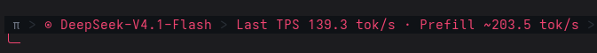

# omp-live-stats

Output-token throughput and estimated prefill speed for Oh My Pi sessions.

The extension shows a compact readout for the last completed response and an
on-demand report for the current branch. It reads the session messages omp
already persists; it writes no extra files and makes no network requests.



## Quick start

Targets omp `18.12.6`.

Install directly from GitHub:

```sh
omp plugin install github:tralamazza/omp-live-stats
omp plugin list
```

Pin a tag or commit by appending `#<tag-or-commit>` to the source.

`omp plugin list` should include `omp-live-stats`. Start a new omp session; the
compact status appears after the first completed response.

For development, clone the repository and link the checkout instead:

```sh
git clone https://github.com/tralamazza/omp-live-stats.git
cd omp-live-stats
omp plugin link .
```

To try it without installing, run from the checkout:

```sh
omp --no-extensions -e ./src/index.ts
```

## Usage

The compact status updates automatically for every main-agent response:

```text
Last TPS 60.0 tok/s · Prefill ~2400.0 tok/s
```

An errored or aborted response adds an `error` or `aborted` marker. A `—` means
the metric is unavailable.

Run `/live-stats` for the current branch's statistics:

```text
Session statistics (current branch)
Responses: 12 · Errors: 0 · Aborts: 0
Last: anthropic/claude-sonnet-4 · stop
Last TPS: 60.0 tok/s · Prefill ~2400.0 tok/s
Session TPS: 58.3 tok/s (12 samples)
Session prefill: ~1800.0 tok/s (12 samples)
Mean TTFT: 620.0 ms (12 samples)
Tokens: input 18324 · output 4821
Cache: read 92000 · write 1200
Prefill is estimated from uncached tokens / TTFT; includes network/queue latency.
```

The report is a ten-line widget below the editor and is not injected into model
context. `/live-stats off` closes the widget; the compact status remains.

## What the numbers mean

| Metric | Definition |
| --- | --- |
| **TPS** | Output tokens divided by the provider-reported whole-request duration, using omp's `calculateTokensPerSecond` helper. Includes reasoning, text, and tool-argument output; reasoning tokens are not added again. |
| **Prefill (estimated)** | `(usage.input + usage.cacheWrite) × 1000 / TTFT`. Cache reads are excluded because those tokens were not newly prefetched. TTFT includes queueing, network, and provider event latency, so this is not server compute speed. |
| **TTFT** | Provider-reported time to the first output event. It must be positive and no longer than the reported request duration. |
| **Session rates** | Weighted by their own denominators: `sum(output) / sum(duration)`, not the mean of per-response rates. |
| **Scope** | Assistant messages on the active main-agent branch, including entries before `/clear` boundaries and compactions. Subagent usage and other branches are excluded. |

`—` appears when the host did not persist timing fields, the response was too
short for a meaningful rate, the timing values were invalid, the response
errored, or the prompt had no uncached tokens. Errors and aborts are still
counted. Statistics are reconstructed from session messages, so a resumed
session restores its metrics when the timing fields were persisted.

`/clear` keeps the session statistics by design; a new session starts empty.

## Put it in the powerline

By default the compact status uses omp's hook-status row below the editor. To
render it inside the powerline bar instead, add the `status` segment to a custom
status-line preset.

If `status` is missing, the first interactive session shows a one-line hint
pointing to the config block. It is shown once per omp process, not on every
session.

This example preserves the built-in `default` preset's segments and options and
inserts `status` after `mode`:

```yaml
statusLine:
  preset: custom
  leftSegments: ["pi", "vim", "model", "mode", "status", "collab", "stream", "path", "git", "pr", "context_pct", "cost"]
  rightSegments: ["session_name"]
  separator: powerline-thin
  segmentOptions:
    model:
      showThinkingLevel: true
    path:
      abbreviate: true
      maxLength: 40
      stripWorkPrefix: true
    git:
      showBranch: true
      showStaged: true
      showUnstaged: true
      showUntracked: true
  showHookStatus: false
```

Add the block to `~/.omp/agent/config.yml`. `preset: custom` is required because
the other presets ignore `leftSegments`/`rightSegments` and none includes
`status`. A custom preset starts with empty `segmentOptions`, so copy the options
above to keep the default path and git rendering. Set `showHookStatus: false` to
avoid rendering the same text twice. If you already have a custom status line,
add `status` to your existing segment list instead of replacing it.

The equivalent settings can be written with `omp config set`; array and record
values take JSON.

## Troubleshooting

| Symptom | Check |
| --- | --- |
| No status text | Is the plugin listed by `omp plugin list`? Is UI available (not print/RPC mode)? If `showHookStatus` is off, `status` must be in your segment list. |
| `—` for TPS or prefill | The host may not have persisted timing, the request may be too short, or the prompt may have been fully cache-read. Errors have no usable rate samples; aborts are measured when their timings are valid. |
| Report is empty | The current main-agent branch has no completed assistant messages. Subagent branches are not included. |
| Metrics change after `/new` | New sessions start empty. Use `/resume` or `/tree` to return to a branch with history. |
| Status survived `/clear` | Intentional: `/clear` adds a reset boundary but keeps the branch's assistant messages in scope. |

## Development

Requires Bun `>=1.3.14` for tests and development dependencies:

```sh
bun install
bun test
```

There is no build step: `omp.extensions` points directly at `src/index.ts`.

- `src/index.ts` — lifecycle handlers, status updates, `/live-stats`.
- `src/stats.ts` — per-response measurement and branch aggregation.
- `src/format.ts` — compact status and ten-line report rendering.
- `test/stats.test.ts` — measurement, aggregation, and formatting tests.

`@oh-my-pi/pi-coding-agent` and `@oh-my-pi/pi-ai` are pinned to `18.12.6` for
types and the TPS helper; omp provides the runtime host.

## License

[MIT](LICENSE) © Daniel Tralamazza
